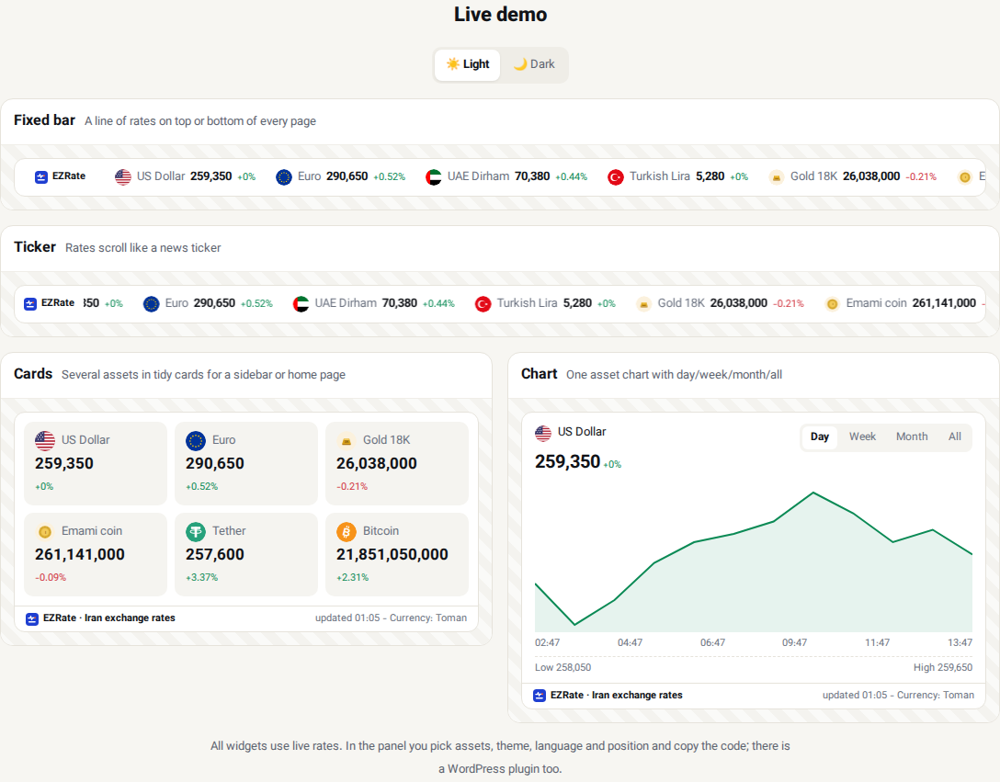

# Iran Exchange Rate & Gold Price Widgets for Any Website — EZRate

[فارسی](README.md) · [Build a widget on EZRate](https://ezrate.me/services/widgets/en)

Show live **US dollar, euro, 18k gold, Emami coin, USDT and Bitcoin** prices on your website with **one line of code**. **No API key**, prices refresh every minute, and it works with any site (WordPress, Joomla, plain HTML, Nuxt, React…).



## Four widget types

| Type | Use |
|---|---|
| **Ticker** | prices scroll like a news ticker — top of the site or under the header |
| **Price bar** | one fixed row of prices |
| **Price cards** | tidy cards for a sidebar or home page |
| **Chart** | one asset with day / week / month / all ranges |

Light or dark theme, **five languages** (Persian, English, Arabic, Russian, Turkish) and prices in **Toman, US dollars, euros, Turkish lira or UAE dirhams**.

## Set up in 3 steps

1. Create a free account at [ezrate.me](https://ezrate.me/auth/register/en).
2. Dashboard › **Widget builder**: choose the type, prices, language, currency and theme (live preview).
3. Copy the code anywhere on your site:

```html
<div class="ezrate-widget" data-ezrate="YOUR_WIDGET_ID" data-lang="en" data-currency="usd">
  <a href="https://ezrate.me/en" title="Iran exchange rates">Iran exchange rates — EZRate</a>
</div>
<script src="https://ezrate.me/widget.js" async></script>
```

## Change the language and currency per page

| Attribute | Values |
|---|---|
| `data-lang` | `fa` · `en` · `ar` · `ru` · `tr` |
| `data-currency` | `irt` Toman · `usd` · `eur` · `try` · `aed` |

Several widgets on one page: add the script **once** and as many `div`s as you like — see [`examples/index.html`](examples/index.html).

## Why this widget

- **Light:** no iframe, no library; the script loads `async` and does not slow the page.
- **Real market prices:** the median of many sources, the same data as [ezrate.me](https://ezrate.me/en).
- **Full right-to-left** support for Persian and Arabic.
- **No API key** in your page's code.
- If the data cannot be reached, the link inside the `div` is shown instead — never an empty box.

## WordPress

Use the ready plugin (shortcode, Gutenberg block, classic widget, fixed bar): **[ezrate-wordpress](https://github.com/ezrate-me/ezrate-wordpress)**.

## Developers

Prices on your own server or app: **[EZRate API](https://github.com/ezrate-me/ezrate-api)**.

[USD price](https://ezrate.me/usd/en) · [Gold price](https://ezrate.me/gold/en) · [Coin price](https://ezrate.me/coin/en) · [USDT price](https://ezrate.me/crypto/usdt/en) · [Widgets](https://ezrate.me/services/widgets/en)
