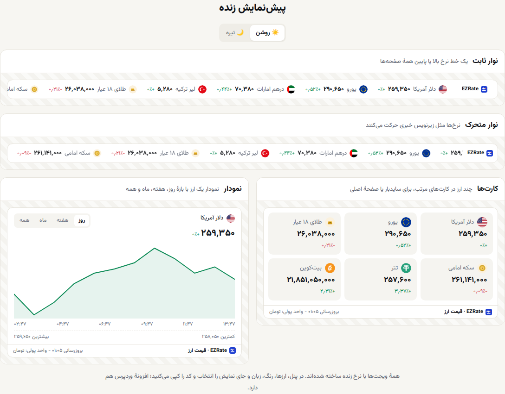

<div dir="rtl">

# ویجت قیمت ارز، طلا و سکه برای سایت — EZRate

[English](README.en.md) · [ساخت ویجت در EZRate](https://ezrate.me/services/widgets/fa)

با **یک خط کد** قیمت لحظه‌ای **دلار، یورو، طلای ۱۸ عیار، سکه امامی، تتر و بیت‌کوین** را روی سایت خود نشان دهید. برای این کار **کلید API لازم نیست**، قیمت‌ها هر دقیقه خودکار به‌روز می‌شوند و ویجت با هر قالب و سیستم مدیریت محتوایی (وردپرس، جوملا، HTML ساده، Nuxt، React و…) کار می‌کند.



## چهار نوع ویجت

| نوع | کاربرد |
|---|---|
| **نوار متحرک (تیکر)** | قیمت‌ها مثل زیرنویس خبر حرکت می‌کنند؛ بالای سایت یا زیر هدر |
| **نوار قیمت** | یک ردیف ثابت از قیمت‌ها |
| **کارت قیمت** | کارت‌های مرتب برای ستون کناری یا صفحهٔ اصلی |
| **نمودار** | نمودار یک دارایی با بازهٔ روز، هفته، ماه و همه |

هر ویجت پوستهٔ روشن یا تیره دارد، به **پنج زبان** (فارسی، انگلیسی، عربی، روسی، ترکی) نمایش داده می‌شود و قیمت را به **تومان، دلار، یورو، لیر یا درهم** نشان می‌دهد.

## نصب در ۳ قدم

1. در [ezrate.me](https://ezrate.me/auth/register/fa) حساب رایگان بسازید.
2. پنل کاربری › **ویجت‌ساز**: نوع ویجت، قیمت‌ها، زبان، واحد پول و پوسته را انتخاب کنید؛ پیش‌نمایش زنده است.
3. کد را کپی کنید و هر جای سایت که می‌خواهید بگذارید:

</div>

```html
<div class="ezrate-widget" data-ezrate="YOUR_WIDGET_ID" data-lang="fa" data-currency="irt">
  <a href="https://ezrate.me/fa" title="قیمت ارز">قیمت ارز — EZRate</a>
</div>
<script src="https://ezrate.me/widget.js" async></script>
```

<div dir="rtl">

`YOUR_WIDGET_ID` شناسهٔ ویجت شماست که در ویجت‌ساز ساخته می‌شود.

## تغییر زبان و واحد پول بدون ساختن ویجت جدید

یک ویجت ذخیره‌شده را می‌توانید در صفحه‌های مختلف با زبان یا واحد پول متفاوت نشان دهید؛ فقط دو ویژگی `div` را عوض کنید:

| ویژگی | مقدارها |
|---|---|
| `data-lang` | `fa` فارسی · `en` انگلیسی · `ar` عربی · `ru` روسی · `tr` ترکی |
| `data-currency` | `irt` تومان · `usd` دلار · `eur` یورو · `try` لیر ترکیه · `aed` درهم امارات |

</div>

```html
<!-- همان ویجت، به انگلیسی و قیمت‌ها به دلار -->
<div class="ezrate-widget" data-ezrate="YOUR_WIDGET_ID" data-lang="en" data-currency="usd">
  <a href="https://ezrate.me/en" title="Iran exchange rates">Iran exchange rates — EZRate</a>
</div>
<script src="https://ezrate.me/widget.js" async></script>
```

<div dir="rtl">

چند ویجت در یک صفحه؟ اسکریپت را **یک بار** بگذارید و هر تعداد `div` که می‌خواهید اضافه کنید. نمونهٔ کامل: [`examples/index.html`](examples/index.html).

## چرا این ویجت؟

- **سبک و سریع:** بدون iframe و کتابخانهٔ اضافه؛ اسکریپت `async` بارگذاری می‌شود و سرعت صفحه را پایین نمی‌آورد.
- **قیمت واقعی بازار:** میانهٔ قیمت ده‌ها منبع؛ همان داده‌های [ezrate.me](https://ezrate.me/fa).
- **راست‌به‌چپ کامل** برای فارسی و عربی، اعداد فارسی.
- **بدون کلید API:** کلید شما در کد صفحه دیده نمی‌شود.
- اگر به داده دسترسی نباشد، لینک داخل `div` به‌جای ویجت نشان داده می‌شود و صفحه خالی نمی‌ماند.

## وردپرس

برای وردپرس افزونهٔ آماده داریم (کد کوتاه، بلوک گوتنبرگ، ابزارک و نوار ثابت بالای صفحه): **[ezrate-wordpress](https://github.com/ezrate-me/ezrate-wordpress)**.

## برنامه‌نویس هستید؟

برای دریافت قیمت‌ها در سرور یا اپ خودتان، از [API قیمت ارز و طلا](https://github.com/ezrate-me/ezrate-api) استفاده کنید.

## لینک‌ها

[قیمت دلار](https://ezrate.me/usd/fa) · [قیمت طلا](https://ezrate.me/gold/fa) · [قیمت سکه](https://ezrate.me/coin/fa) · [قیمت تتر](https://ezrate.me/crypto/usdt/fa) · [ویجت قیمت ارز](https://ezrate.me/services/widgets/fa) · [تابلوی قیمت صرافی](https://ezrate.me/services/exchange-board/fa)

</div>
